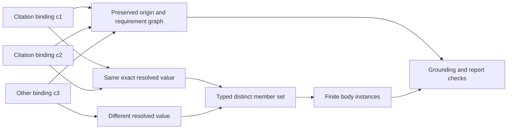

# Finite intent, not a general-purpose program

The owner/agent workflow is: scope and brainstorm, retrieve/admit knowledge through
Writfold, draft an exact plan, author a Weft review, inspect its checked report,
finalize/admit the unchanged justified plan, then let Writfold track and execute it.
Material changes reopen affected findings; live effect guards are rechecked.

Weft expresses verification obligations and hypothetical reasoning. The agent owns
planning; Writfold owns procedure/control/run graphs and effects. Logical implication
is useful in Weft. Execution branches and loops belong to the admitted procedure.
Native finite sets and bounded quantifiers do not make this language Turing-complete.

## One set value, complete provenance



Deduplication is not permission to omit an expired alias, contrary witness or
required dependency. Failed resolution cannot become an empty collection.

## Pretty syntax, fixed meaning

```text
citation_set_s1 := {c1, c2};
all_inputs := {c3, ...citation_set_s1};

check inputs_ready:
    forall c in all_inputs { usable(c) };
```

`:=` is a single immutable binding form, with no `let` alias or reassignment.
Quantifier variables are lexical; their domains use the outer scope. Profiles define
the predicates and nominal types. A citation's spelling does not establish its
identity or usability.

`assume` remains hypothetical, even for a quantified statement. Weft reports what
is proved, conditional or not established; existing Writfold policy determines
whether an explicitly conditional plan may proceed. This does not weaken required
gate floors or add a blanket Weft veto.

## A witness is scoped to what was actually proved

For premises saying exactly one of A/B holds:

| Checked model | A | B | Exists a true member | Every member true |
| --- | --- | --- | --- | --- |
| Left alternative | true | false | true, witnessed by A | false, B is a counterexample |
| Right alternative | false | true | true, witnessed by B | false, A is a counterexample |

Existence is entailed, but neither A nor B is a uniform witness. Universal truth is
refuted, but neither individual member is uniformly false. Reports must preserve
model-relative witnesses instead of inventing a stronger per-member conclusion.

For empty domains, universal truth is vacuous and existence is false. The report
shows the empty domain and its coverage; this proves nothing about discovery of all
real requirements. `exists c in S { true }` is an explicit non-emptiness obligation.

The original calculus pass does not qualify these new constructs. Revision 2 adds
Q01-Q10 and a mandatory proof gate before their Rust implementation.
