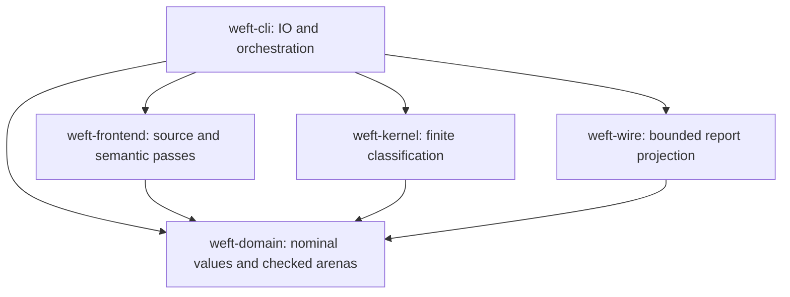

# Rust implementation boundaries

The revision-3 Lean calculus gate — including the A01–A08 set-algebra families —
passed before these Rust crates gained their algebra implementation. Rust
correspondence still needs executable qualification; no refinement theorem
is inferred from a shared design or differential agreement.

## Set-algebra implementation shape

Union, intersection and difference extend `SetKind` as binary nodes and
materialize through the same `TheoryBuilder::add_set` normalization path as
literals and spreads; `OriginKind::SetOperation` links both whole operands, so
removed members and the entire right operand of a difference stay reachable.
Membership and subset lower to checked `FormulaOp::Literal` nodes carrying
`NodeDetail::Membership` and `NodeDetail::SetComparison` (with the deterministic
first-left counterexample), exactly like set equality. Both operand traversals
are charged before any filtering; `set_member`/`set_subset` use hash sets, so
charging stays linear in the operands actually scanned.

## Selected crate dependencies

The immutable crate plan remains the baseline. The narrow current
[engineering adoption](../qualification/engineering-adoption.json) additionally
permits CLI → domain for direct use of shared nominal contracts. It avoids
forwarding re-exports and duplicate orchestration types. Report integration tests
may depend on the real frontend/kernel; CLI tests may decode JSON. These are
Cargo **development** dependencies, not production edges.

Wire does not call the kernel. Each valuation is evaluated once; exact premise
truth is retained in a row-major packed bit matrix alongside compact trace rows.
Supporting/refuting models retain their actual node values. Atom assignment order
matches Lean: the first active atom is the most-significant bit, independent of
its global interning index. Witnesses remain relative to that assignment.

## Representation and limits

- Canonical decimal naturals are exact at arbitrary precision within the selected
  source-digit budget. This equality-only language needs no arithmetic library
  and does not wrap into a machine integer or repeatedly format large values.
- Formula nodes and source-origin nodes use separate backward-only arenas.
  Values are interned once; duplicate set members retain all origin links.
- Parser recursion and intrinsic expression/set depth have an architectural cap
  of 64, also covering left-associated connective chains. The effective limit is
  the smaller of the requested limit and that cap. This is an implementation
  resource profile, not a change to finite logical meaning.
- Construction, spread materialization, nested instances, source metadata snapshots
  and prepared query/origin closure consume aggregate work. Failure cannot reset
  a sibling's or instance's budget. Valuations, actual node/premise visits, trace
  rows and serialized bytes have separate explicit bounds.
- Ordinary semantic failures retain earlier safe findings and block dependent
  later checks. If even the complete source/check metadata cannot fit the work
  budget, compilation returns diagnostics instead of allocating an unbounded or
  incomplete assessment. No positive result is claimed in that case.
- Whole-body name/type checks precede finite expansion, even for empty sets.
  Empty type variables may be constrained by a later consistent predicate use;
  a type still required but unresolved at the end is diagnosed at its origin.

## Source quality boundaries

AST checks enforce nominal construction shapes, source dependencies, cohesive
module/function sizes and evident unsafe/panic operations. They do not prove
semantic validation or resolve arbitrary Rust value flow. Compiler-resolved
Clippy lints are forbidden for the actual workspace and tool targets, and their
rejection paths are calibrated against real compilation.

Calibration exposed a concrete limitation in the admitted compiler: `unwrap`
and `expect` inside macro expansions were not diagnosed by those typed lints.
The source policy therefore rejects invoked `unwrap`/`unwrap_err` and
`expect`/`expect_err` syntax inside macros, regardless of receiver. Use explicit
fallible code outside the macro instead. Ordinary custom fallible methods such
as the parser's `expect` are not confused with standard-library panics; opaque
syntax tokens such as `Token![unsafe]` are not executable unsafe operations.
The combined gate records both the compiler result and the macro-policy result;
it does not relabel the observed compiler gap as a successful rejection.

## Publication is not arena allocation

The report links declarations to successful set/hypothesis materializations,
including unused hypotheses. Failed or unmaterialized bindings have no invented
member count or empty value. Intermediate arena entries left by failed lowering
are not completed declarations. Quantifier origins include both the captured
domain and all actual instantiated bodies; report closure preserves those links.

All local outputs remain hypothetical/unresolved with no Writfold grounding or
effect authority. Actual citation, freshness, plan/run admission, execution and
learning paths remain the separately owned Writfold integration prerequisites.
