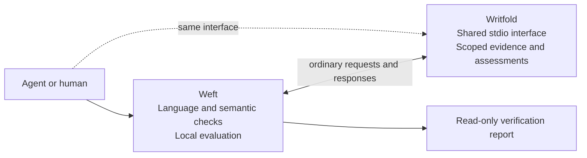
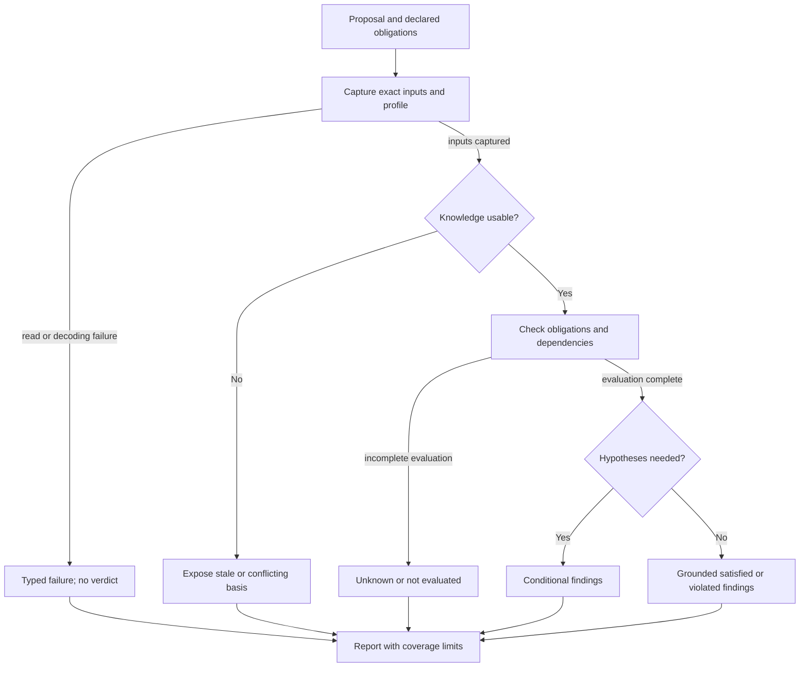
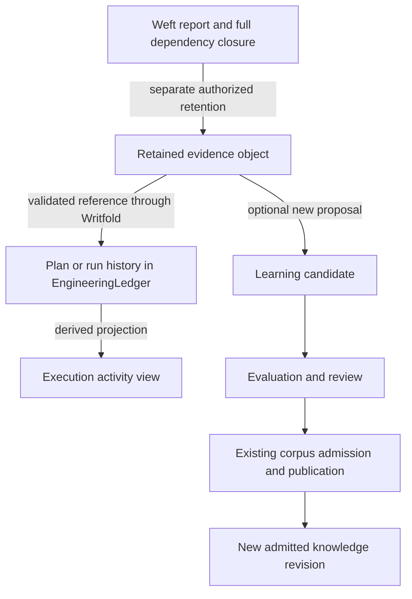

# Weft, visually

Design diagrams, not implemented services. Solid arrows describe the proposed
assessment boundary; the final diagram explicitly describes possible later
integration. No graph edge grants authority.

## One client interface, not a new VM

The local evaluator is not a remote instruction set. A later proof backend would
be selected and qualified separately; no solver is required by this diagram.

## From a proposed change to honest findings

Mixed outcomes stay visible. An unusable premise can explain a historical
comparison but cannot justify a current grounded finding. A pure logical
inconsistency or incomplete search, if such a profile is selected, stays a
separate result rather than entering an ordinary satisfied/violated branch.

## Report surface

This is a discussion artifact, not an application screenshot. The
[report proposal](verification-report.md) defines the independent information
that the presentation must preserve.

## How a report could later enrich execution history

This is **future integration**, not an existing Weft attachment API. A report may
be useful for review without being a trusted execution-gate receipt. Ledger
references and activity rows cannot publish knowledge; admission and current
effect authorization remain distinct.

The Context, Execution and Learning graphs are semantic views in Writfold's
revision-5 design. Weft adds an explanation/dependency artifact, not a fourth
knowledge database or another operational state owner.
