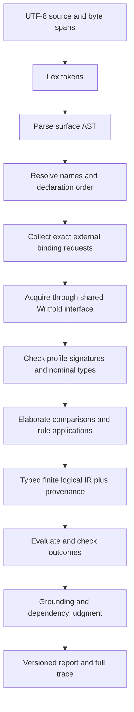

# Rust architecture and compiler pipeline

## Crate boundaries

| Crate | Owns | Allowed dependencies |
| --- | --- | --- |
| `weft-domain` | Validated nominal local IDs, spans, typed values, IR, evidence/report domain enums | Pure numeric/value libraries only; no serde, filesystem, process, network or clock |
| `weft-frontend` | UTF-8 lexer, parser, source AST, name/type passes, lowering with provenance | domain; no IO |
| `weft-kernel` | Finite interpretation/classification, dependency and grounding judgments, checked trace construction | domain; no IO |
| `weft-wire` | Bounded versioned JSON DTOs and checked conversions, deterministic report projection | domain, serde/serde_json; raw values stay here |
| `weft-writfold` | Shared-stdio client, request/session matching, capability refusal and evidence acquisition | domain/wire and an exact owner-published Writfold contract; process IO only here |
| `weft-cli` | Arguments, source reading, orchestration, cancellation, presentation and exit categories | frontend/kernel/wire/client |

Introduce a crate only with a real owned implementation. The layout is a target
contract, not permission to add empty crates or stub client methods. Keep direct
logical checks and eventual REPL on one evaluator. No plugin VM or generic effect
scheduler. Writfold retains all authoritative execution services.

## Pass order

Local syntax/analysis may stop before external acquisition, explicitly reporting
unresolved bindings. A local finite proof over hypotheses is not a grounded KB
assessment. Required backend capabilities cannot be mocked to make that path pass.

## Implementation details

Borrow token slices from one source buffer; retain byte spans instead of copying
source fragments into every node. Intern names/atoms once and use private validated
indices thereafter. Check recursive nesting, token/source sizes, atom counts,
valuation work, response frames and trace output against explicit budgets.
Avoid allocating a full truth table when streaming valuations is sufficient.

Name resolution rejects duplicate/shadowed identifiers, forward references and
wrong binding kinds. Typechecking prevents Boolean/natural/text/identity coercion,
unknown fields/predicates and wrong signature arity. `by` accepts only pinned rule
bindings; it is not a request to trust a rule name. Substitution is explicit and
capture-free because the admitted fragment has no expression binders.

Represent partiality with closed enums: absent/denied/expired/invalid/unsupported
and budget exhaustion are distinct. Never use default false/empty data as a failed
read fallback. Strongly distinguish requested references, resolved bindings,
assessed evidence and justified conclusions at the type boundary.

## Quality and testing obligations

Private checked newtypes for BindingId, AtomId, CheckId, TraceId, SourceSpan,
QueryDigest and every external identity domain. No public tuple fields, string
aliases, Boolean status soup, Any, unchecked domain Deserialize or generic JSON
maps in the semantic core. `forbid(unsafe_code)` throughout.

Compile-fail cases reject cross-kind IDs, raw-to-validated conversion and invalid
state promotion. Regression tests cover observable syntax/precedence/Unicode,
nominal types, inconsistent hypotheses, required-but-unused needs, denied/stale
inputs, budgets, wrong-context reuse, trace closure and malformed peer responses.
Do not test copied implementation text or bless incidental wording snapshots.

Differentially compare exact Lean and Rust logical outcomes and witnesses on
non-vacuous finite cases and targeted mutations. Record source/tool identities;
this is conformance evidence, not a refinement theorem. Review production symbol
mapping and every trusted external interpretation separately.

Diagnostics point at the original source even after sugar/lowering. JSON carries
stable codes and typed details; human text explains the error without requiring
an agent to infer meaning from a stack trace. No arbitrary shell command evaluation.
